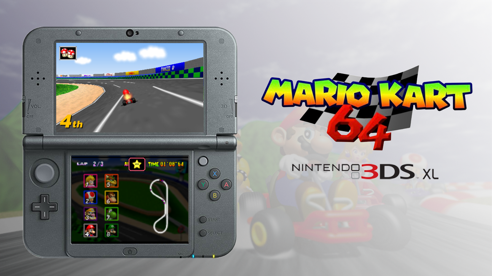

# Mario Kart 64 3DS Port Complete

<p>
  
  
</p>



A native Mario Kart 64 port for the Nintendo 3DS family, maintained by Epic.
This project continues [EstebanPdN's original Mario Kart 64 3DS port](https://github.com/EstebanPdN/mario-kart-64-3ds),
based on SpaghettiKart, with resource-management fixes, rendering corrections
and optional gameplay improvements.

[Original project](https://github.com/EstebanPdN/mario-kart-64-3ds) · [Discord community](https://discord.gg/qwcTTDqbhu)

This is an unofficial fan project, not affiliated with Nintendo or Harbour Masters. No ROM, O2R archive, save or extracted gameplay resources are included. A compatible USA ROM is required.

## 💬 Community

Join [Epic's Discord community](https://discord.gg/qwcTTDqbhu) to discuss the
port and share feedback. When reporting an issue, include your console model,
game version, relevant settings and the steps needed to reproduce it.

## ⬇️ Download and Installation

1. Install the CIA with FBI, or launch the 3DSX with Homebrew Launcher.
2. Place a big-endian USA ROM at `sd:/3ds/MK64/mk64.z64`.
3. First launch validates and extracts `mk64.o2r`. Keep the console charged; START cancels extraction safely.

Later launches reuse the archive; an existing compatible SpaghettiKart O2R can also be used. Upgrades replace only the application: retain `sd:/3ds/MK64/` to preserve saves, ghosts and settings.

## ⚙️ Features

- **Resource lifetime fixes** — bounded caches, GPU-safe texture recycling and complete course/kart resets on race transitions, including retries.
- **Old 3DS I/O improvements** — revised heap partitioning and a bounded compressed-entry cache reduce repeated SD reads without removing memory-safety protections.
- **Rendering corrections** — depth/culling, transparent trees and water, podium shadows, results viewports and credits transitions.
- **Dual-screen UI** — five HUD layouts, native item graphics, crisp scrolling course minimaps, blurred menu backdrops and original-style RANDOM CUP / AUTO artwork.
- **Audio and feedback** — prioritized effect requests, positional CPU sounds, hit/finish voices and opponent reaction effects.
- **Optional modern logic** — real CPU item-box collection, adjusted CPU item rules and penalties, smoother pack pacing, road-following shells and held-brake reverse.
- **Random cups and AUTO** — four-race random cups and spectator cups driven by the game's CPU logic.
- **Solo VS and Battle** — race against seven CPUs in VS, or face three arena bots in four-kart Battle, with a single full-screen view.
- **Timing and presentation** — an independent race clock, synchronized transitions and a selectable 30 FPS frame limiter.
- **Animated 3D HOME banner** — a front-facing logo and waving flag, without HOME's default continuous rotation.

Modern logic can be toggled under Gameplay. Rendering, audio and UI fixes remain
active with it disabled. See [FIXES.md](FIXES.md) and [CHANGELOG.md](CHANGELOG.md)
for the full change overview.

Select VS or Battle under **1P GAME**. VS races against seven CPUs. Battle uses
the original arenas and three-balloon rules against three bots; the last survivor
wins. After elimination, use your one-use bomb, then spectate the remaining bots.
Pause and quit remain available. Battle bots work with modern logic disabled too.

The frame limiter caps presentation at 30 FPS. With it off, rendering can reach
60 FPS when workload permits. Performance varies by console and course.
Local multiplayer is not available.

## 🎮 Controls and Configuration

| Control | Manual racing |
| --- | --- |
| Circle Pad | Steer; up/down selects item throw direction |
| A | Accelerate; held A carries through pause → Continue |
| B | Brake; hold through a stop to reverse with modern logic |
| R | Hop / drift |
| L or Y | Use item |
| X | Hold to look behind |
| SELECT | Switch camera distance |
| START | Pause / continue |
| C-Stick | Hold for configured Turbo Speed |
| ZL | Toggle configured Turbo Speed on/off |
| Touch | Lower-screen menus and settings |

Press L on Game Select to open **Display**, **Gameplay** and **Developer** settings.
The in-race menu also has a **Pause** page for continue/quit. HUD layout,
speedometer and other meters are configured under Display.

**Turbo Speed** fast-forwards the game, including AUTO, menus and ceremonies;
it does not upgrade your kart. Hold C-Stick to fast-forward, or press ZL to toggle
it. Manual race
entry/retry resets Turbo; AUTO retains it across courses and retries. A fresh
game launch starts with Turbo off.

| Fresh setting | Default |
| --- | --- |
| HUD layout | Clean |
| Render distance | Low |
| Modern logic | On |
| Frame limiter | Old 3DS: On / New 3DS: Off |
| ZR debug | Off |
| Logging | Off |

Saved settings take precedence. Unsupported HUD meter combinations appear red.
Time Trials hide rank; title demos hide the upper HUD. Modern logic changes take
effect next race.

## 🎲 Random Cups and AUTO

| Menu | SELECT action |
| --- | --- |
| GP Map Select | Four random tracks with the chosen driver/level |
| Game Select | ALL RANDOM: random driver; 150cc or Extra each course |
| Character Select | AUTO using the cursor's driver |

Time Trial Map Select has no random cup button. Extra is the mirrored course mode. The award ceremony can be skipped with A or START.

AUTO is available in GP, VS and Battle. The CPU controls every kart, and the
selected driver owns the result even when you switch the camera to another
driver. Modern logic also applies in AUTO when enabled. Gameplay view is the
default. Battle rankings follow balloon counts, with eliminated drivers last.

Circle Pad / D-pad left or right changes the observed driver. A/B/X/Y switches
between gameplay and cinematic views in GP/VS, or near/far gameplay views in
Battle. Driving and item inputs are disabled; pause, continue, retry and quit
remain available.

GP AUTO advances through results and retries automatically. VS/Battle confirms
the selected result action. GP AUTO ends with the original fourth-place no-trophy
ceremony. AUTO does not save awards or unlock progress.

## 🛠️ Diagnostics

The **Developer** page includes:

- **Memory dump** — export performance samples, settings and resource data to
  `sd:/3ds/MK64/dump/` for bug reports.
- **Logging** — record startup, runtime, installer and fault logs. Off by default;
  manual dumps and FPS displays still work with logging off.
- **Clean dumps** — remove diagnostic files without touching ROMs, O2R archives,
  saves or settings.
- **ZR debug** — hold ZR to advance through checkpoints and finish a race.
  Off by default.

## 🏗️ Building

Initialize pinned submodules recursively, then build:

```sh
git submodule update --init --recursive --depth 1
./platform/3ds/build.sh
```

The first configuration downloads pinned build dependencies, so an internet
connection is required unless they are already cached. A ROM is not needed to
compile; the console needs a ROM or compatible O2R archive to play.

See [BUILDING.md](BUILDING.md) for setup and build instructions,
[ARCHITECTURE.md](platform/3ds/docs/ARCHITECTURE.md) for the code map, and
[RELEASING.md](RELEASING.md) for packaging instructions.

## 📁 Project Structure

| Location | Purpose |
| --- | --- |
| `platform/3ds/` | Maintained runtime, adaptations, artwork and packaging helpers |
| `third_party/SpaghettiKart/` | Pinned production game/engine dependencies |
| `build-3ds/game/` | Generated CIA, full-game 3DSX and hash manifest |
| `docs/images/` | README artwork |

## 🫡 Credits

- **Epic** — continued 3DS runtime, resources, rendering, audio, UI/input and gameplay fixes.
- **EstebanPdN** — original [Nintendo 3DS port](https://github.com/EstebanPdN/mario-kart-64-3ds).
- **Harbour Masters and contributors** — [SpaghettiKart](https://github.com/HarbourMasters/SpaghettiKart), libultraship and Torch.
- **N64 decompilation and 3DS homebrew communities.**
- **SM64 3DS Port Ultimate** — techniques studied from the [related project](https://github.com/Epic0522/Super-Mario-64-3ds-port---Ultimate).
- **Codex** — assisted implementation and verification.

See [THIRD_PARTY_NOTICES.md](THIRD_PARTY_NOTICES.md) for source origins and
third-party license notices.
